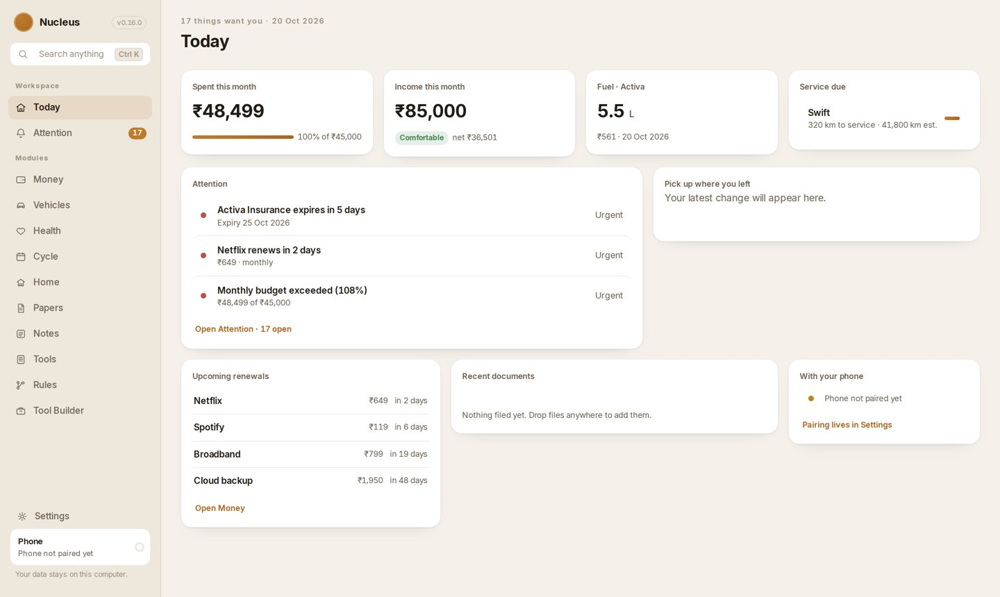
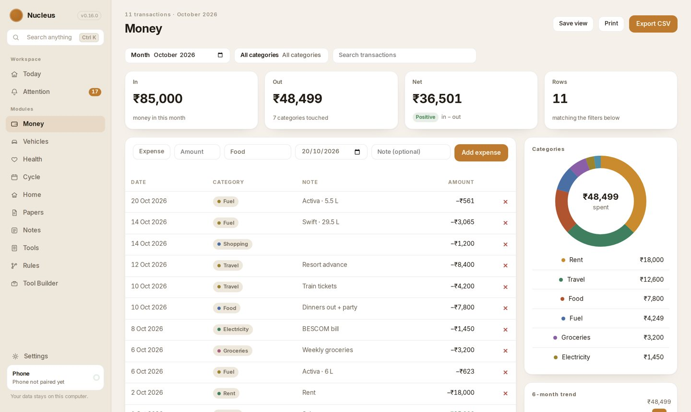
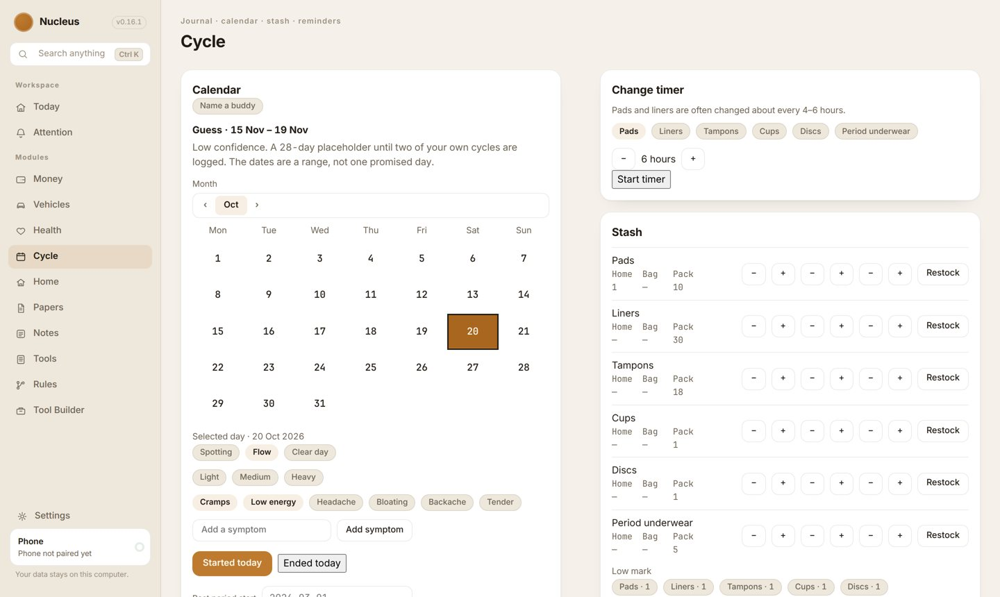
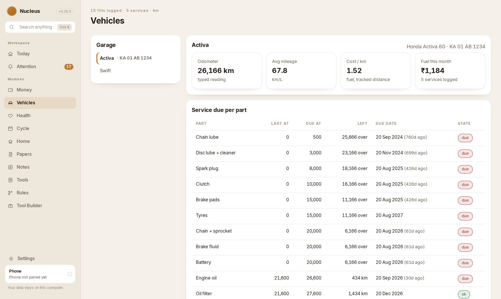
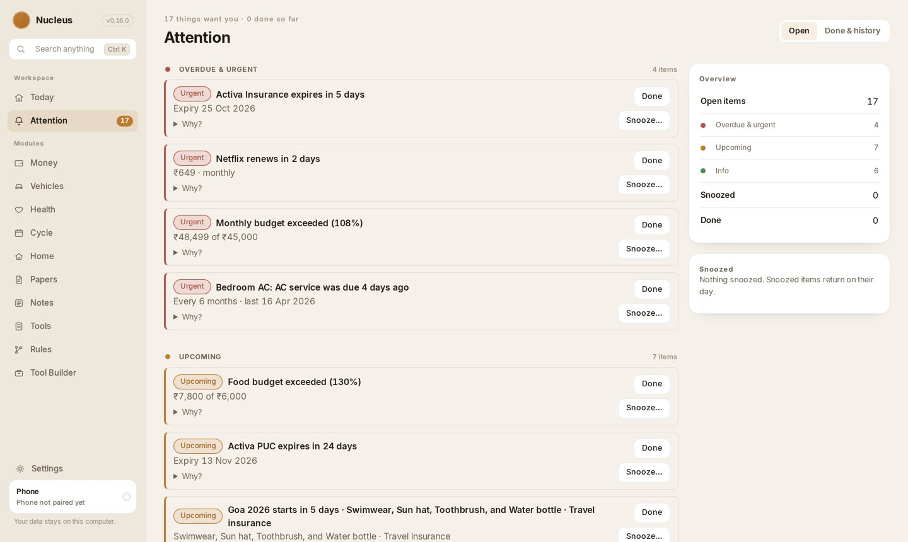
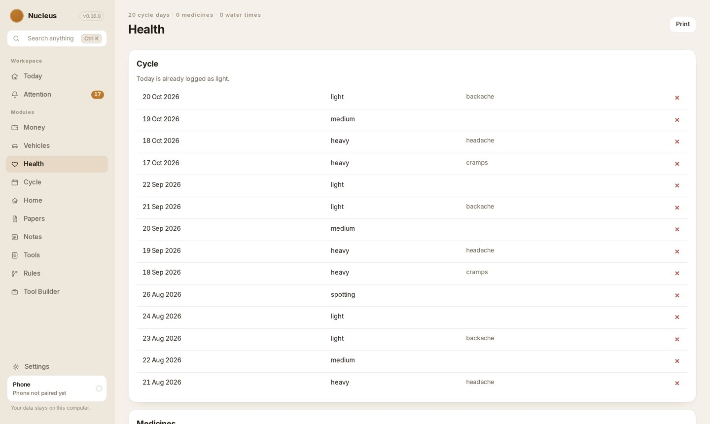
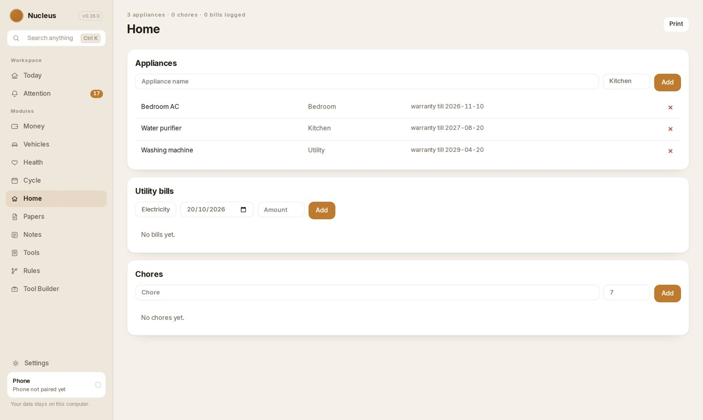
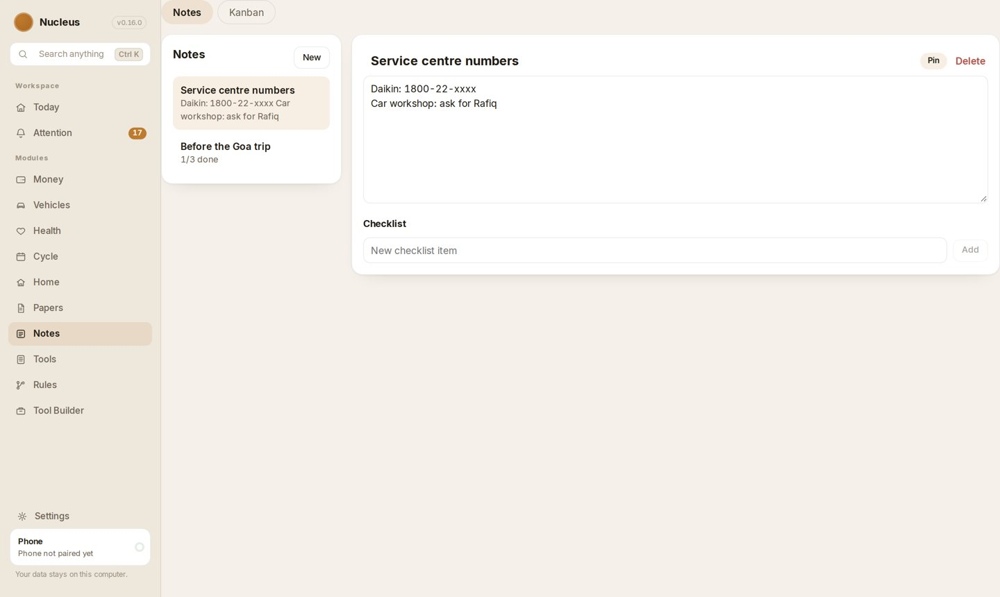
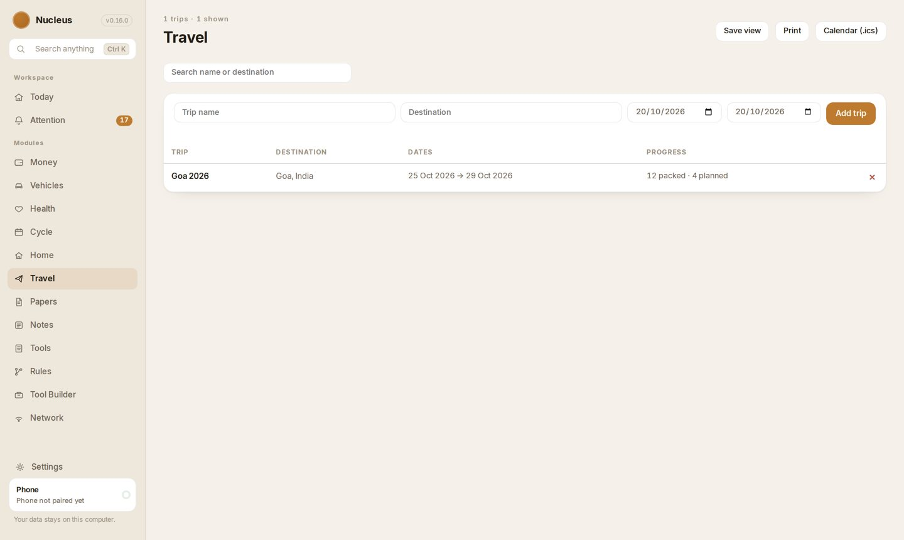
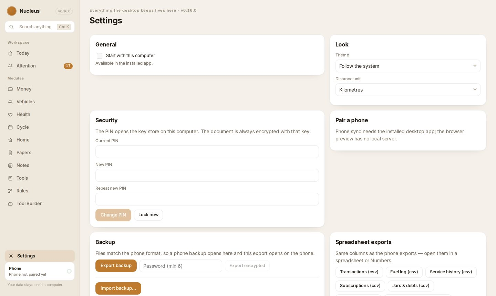

# Nucleus

Nucleus is a private, local-first personal platform for vehicles, money, travel, home, notes, media and tools. Records stay on the device, encrypted. An optional Online switch, off by default, can fetch weather, currency rates and holidays without sending those records anywhere.

One APK for the phone. Installers for Windows and Linux on the desktop. Both keep each other in sync over Wi-Fi.

  

## What it looks like

| Money | Cycle | Vehicles |
|:---:|:---:|:---:|
|  |  |  |
|  |  |  |
|  |  |  |

These screenshots run on the app's own sample dataset — Settings → Data → Add sample data. No real records. The desktop app shown here is the same document as the phone, side by side over Wi-Fi.

## Install on the phone

[Latest release](https://github.com/Soldier0x0/Nucleus/releases/latest)

1. Open that page.
2. Download the APK. The file is named `nucleus-v0.N.apk`.
3. Open the file and install it.

A first install uses that same file. If Nucleus is already on the phone, install the new file over it.

> Do not uninstall. Uninstalling wipes the data on the phone.

Only the latest release is needed. Skip the older versions.

If Android blocks the file, allow the browser or Files to install unknown apps, then open the APK again.

## Install on the desktop

The same release carries the desktop installers: `-setup.exe` and `.msi` for Windows, `.AppImage` and `.deb` for Linux. Download one from the [latest release](https://github.com/Soldier0x0/Nucleus/releases/latest) and install it the usual way. The desktop app opens the same encrypted document and keeps the phone in sync over Wi-Fi.

## Releases

What each version is for is in [CHANGELOG.md](CHANGELOG.md). One section per published version, newest first. One pull request documents only the version it publishes, in short bullet points of what changed. The workflow fails if the changelog also has a section for a later version that has not shipped. A note that only says the app is the same as the previous one does not publish.

The Android workflow runs on the free GitHub runner. It reuses the Gradle cache between runs, and it skips the APK when a change is only docs, the changelog, or the README. A green pull-request build is the APK that gets published, so a merge does not compile that same git tree again. A release still needs that green APK and honest notes for that one version. It does not need a section for the version after that.

## License, privacy and terms

Nucleus is open source under the MIT license — [LICENSE.md](LICENSE.md). The bundled fonts and icons and the data sources keep their own licenses: [NOTICE.md](NOTICE.md) and [docs/licenses/](docs/licenses).

- [Privacy: what leaves the device](docs/PRIVACY.md) — records never leave it, Online fetches are named.
- [Terms of use](docs/TERMS.md) — plain-language terms for the published releases.

## Support the project

The app is free. If it helps you:

- [GitHub Sponsors](https://github.com/sponsors/Soldier0x0)
